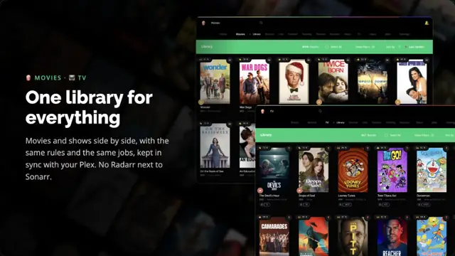
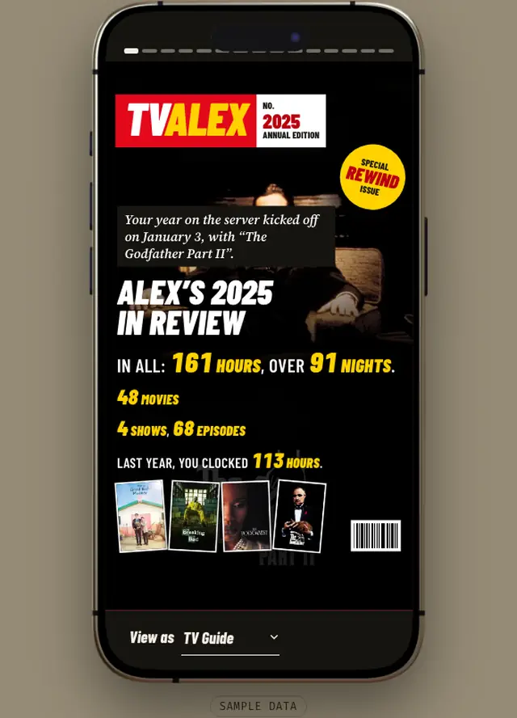
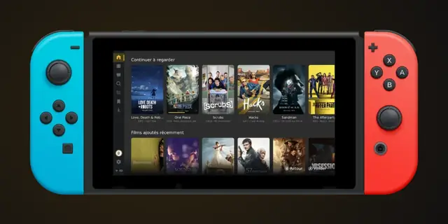
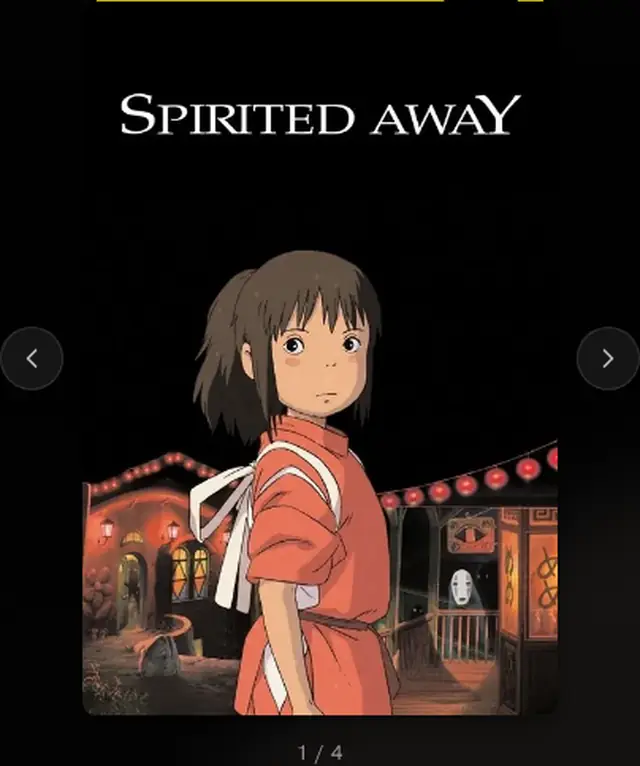
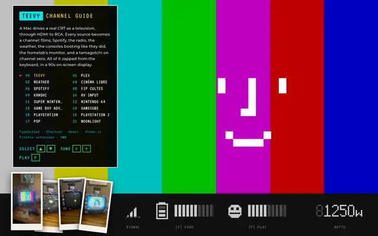

I'm Thomas, Product Engineer at [@coopTilleuls](https://les-tilleuls.coop/) in Nantes. I love building interfaces, most of them about culture and cinema.

<table>
  <tr>
    <td width="50%"> <b>sensorr</b> · your friendly Digital Video Recorder</td>
    <td width="50%"> <b>sensorr wrapped</b> · a wrapped for every friend, every year</td>
  </tr>
  <tr>
    <td> <b>GMCA</b> · one controller-first client for any media center</td>
    <td> <b>cinetropes</b> · films by their tropes and mood · coming soon</td>
  </tr>
  <tr>
    <td colspan="2"> <b>teevy</b> · a Mac drives a real CRT as a television · not for release</td>
  </tr>
</table>

More on [thcol.in](https://thcol.in) · [oleoo](https://github.com/thcolin/oleoo) · [react-responsive-virtual-grid](https://github.com/thcolin/react-responsive-virtual-grid) · [me@thcol.in](mailto:me@thcol.in)
