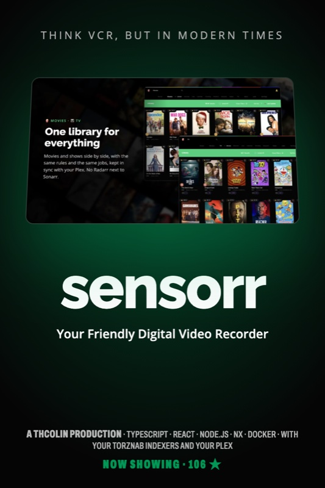
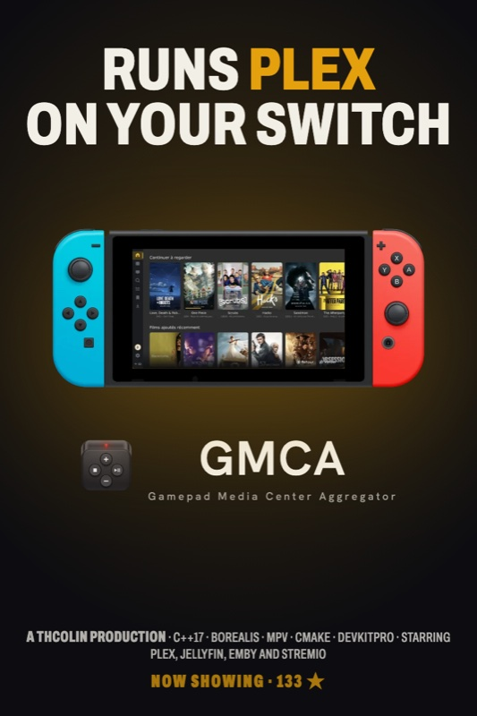
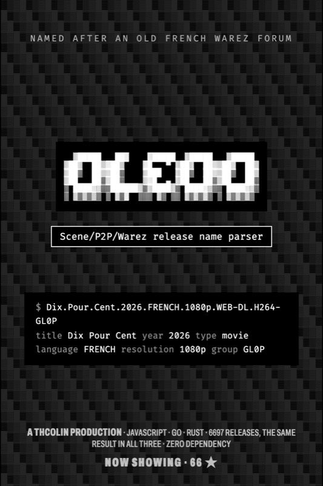
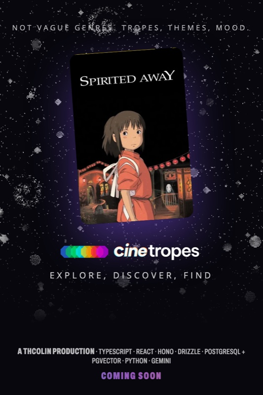
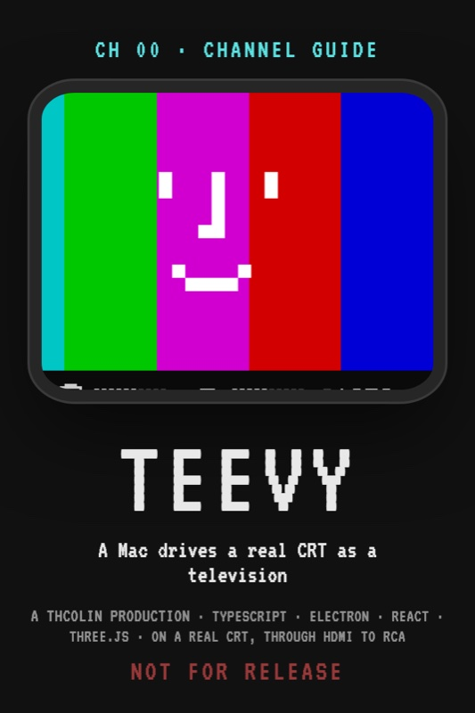

I'm Thomas, Product Engineer at [@coopTilleuls](https://les-tilleuls.coop/) in Nantes. I love building interfaces, most of them about culture and cinema.

<b>NOW SHOWING</b>

  
  
  

<b>COMING SOON</b>

  
  

More on <a href="https://thcol.in">thcol.in</a> · <a href="mailto:me@thcol.in">me@thcol.in</a>

