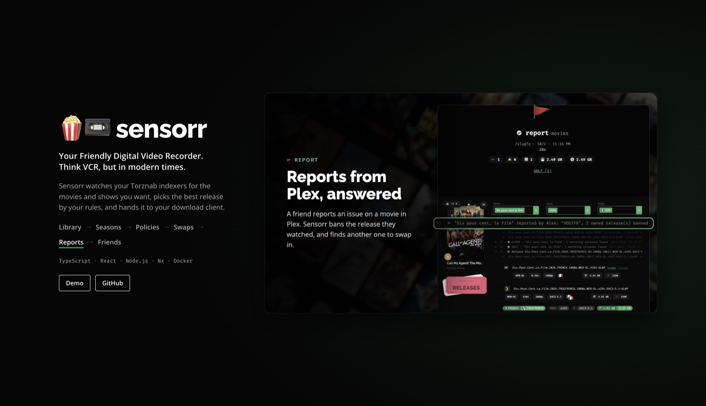
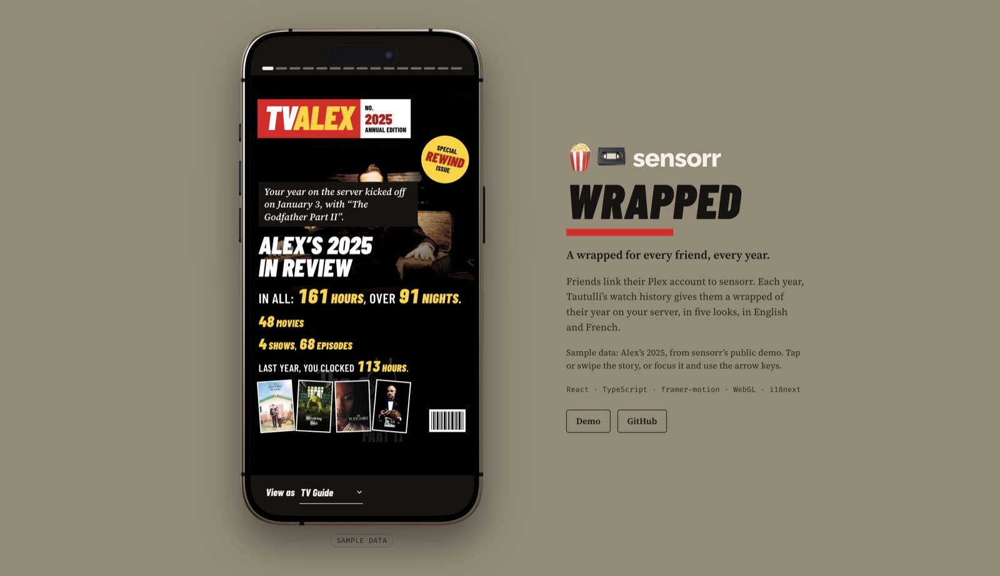
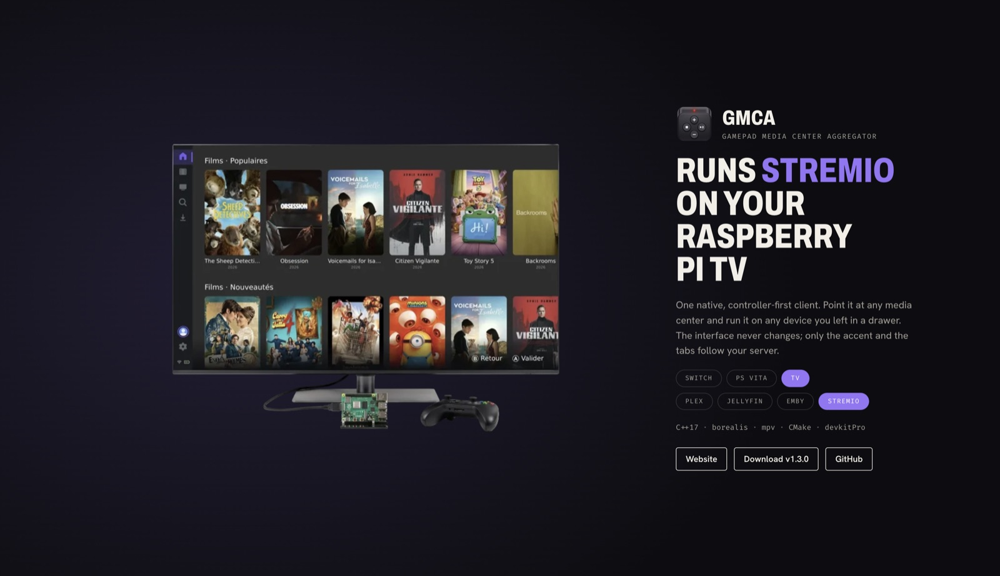
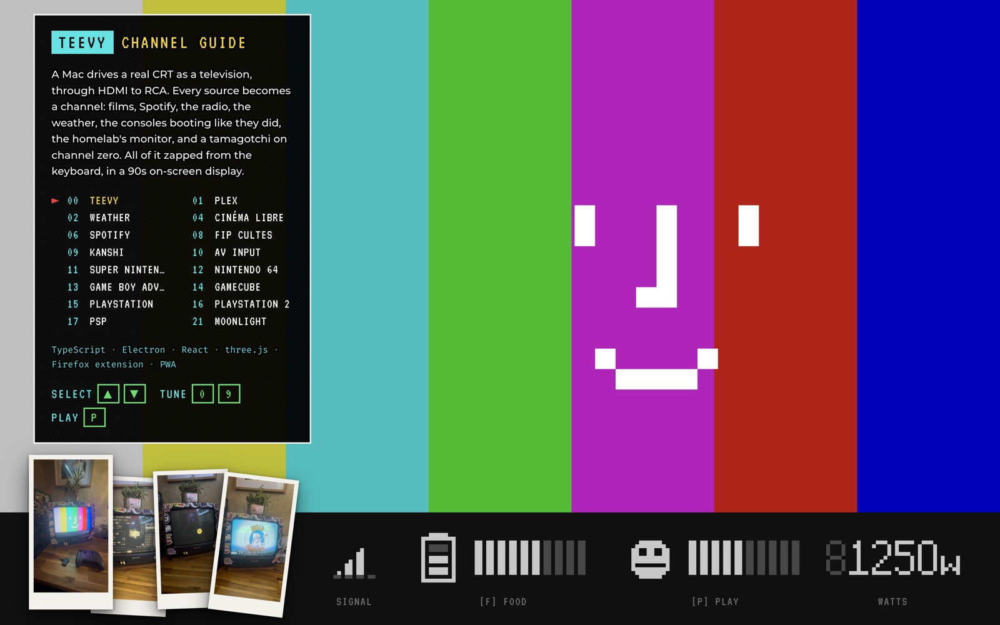
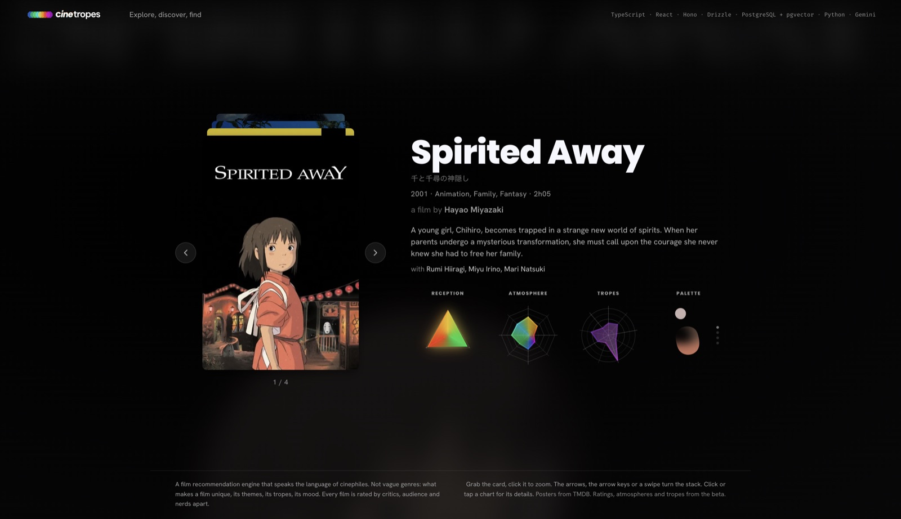
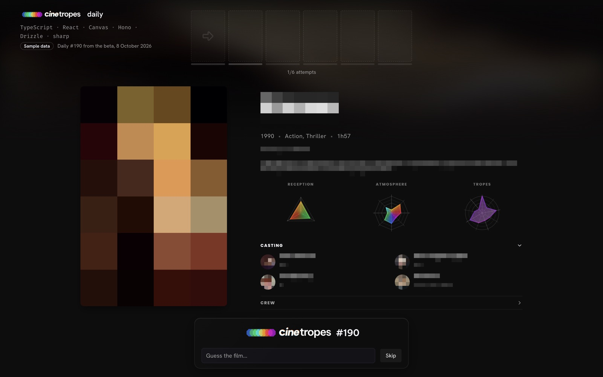

# Thomas Colin

Product Engineer, worker at [@coopTilleuls](https://les-tilleuls.coop/) in Nantes. Lead developer, architect, designer and instructor.

I love building interfaces, and most of mine end up being about culture and cinema: a video recorder for the movies and shows you want, a recommendation engine that talks like a cinephile, a media center you drive with a gamepad, a real CRT that works as a TV.

Every project below has a live demo on **[thcol.in](https://thcol.in/#projects)**.

<table>
  <tr>
    <td width="50%" valign="top">
      
      
<b><a href="https://github.com/thcolin/sensorr">sensorr</a></b> Your friendly Digital Video Recorder. Think VCR, but in modern times.

    </td>
    <td width="50%" valign="top">
      
      
<b><a href="https://github.com/thcolin/sensorr">sensorr wrapped</a></b> A wrapped for every friend, every year, from their Plex watch history.

    </td>
  </tr>
  <tr>
    <td width="50%" valign="top">
      
      
<b><a href="https://github.com/thcolin/gamepad-media-center-aggregator">GMCA</a></b> One controller-first client for Plex, Jellyfin, Emby and Stremio, on a Switch, a PS Vita or a TV.

    </td>
    <td width="50%" valign="top">
      
      
<b>teevy</b> A Mac drives a real CRT as a television, zapped from the keyboard. Built for me, not for release.

    </td>
  </tr>
  <tr>
    <td width="50%" valign="top">
      
      
<b>cinetropes</b> A film recommendation engine built on themes, tropes and mood rather than genres. In beta.

    </td>
    <td width="50%" valign="top">
      
      
<b>cinetropes daily</b> Guess the film of the day in six attempts. In beta.

    </td>
  </tr>
</table>

Also: [oleoo](https://github.com/thcolin/oleoo), a scene release name parser for JavaScript, Go and Rust, and [react-responsive-virtual-grid](https://github.com/thcolin/react-responsive-virtual-grid).

[me@thcol.in](mailto:me@thcol.in)
