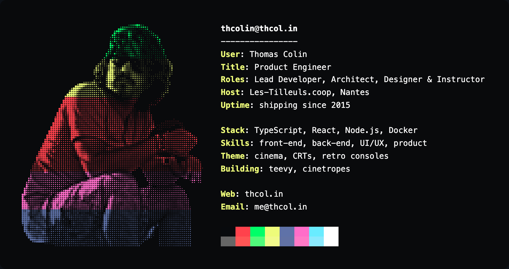
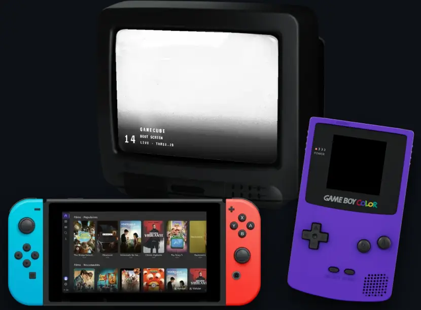
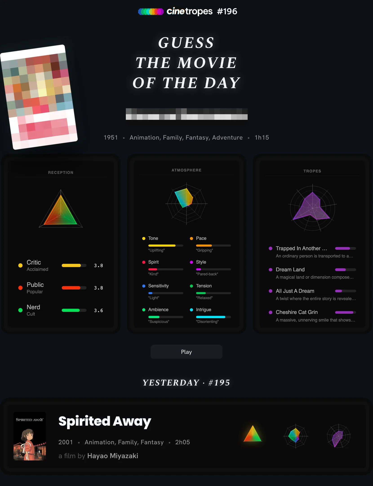
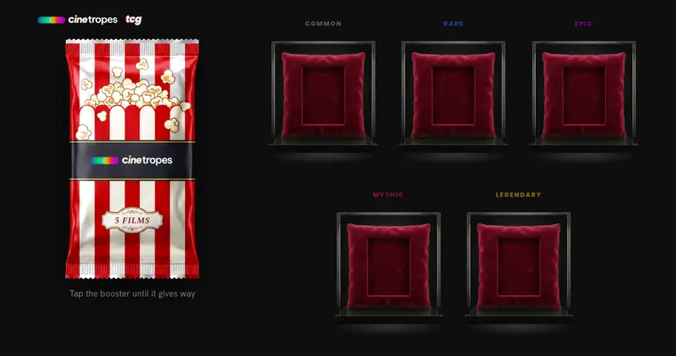
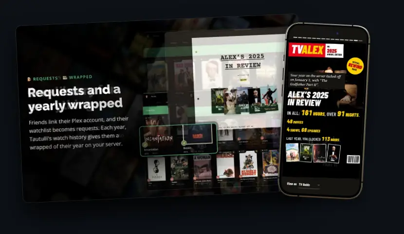
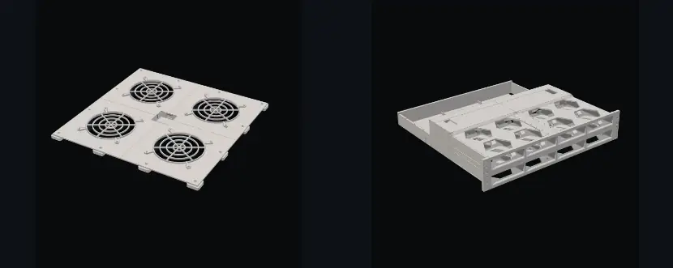

  

  Product engineer at <a href="https://les-tilleuls.coop/">Les-Tilleuls.coop</a>, in Nantes. 
  I design and build interfaces, from the first sketch to the shipped screen.

  On my own time, I turn what I use every day into ideas: 
  my CRT becomes a tamagotchi and gets plugged into my Plex, 
  I make sure I can access my media server from all my devices, 
  I DIY on my rack, and I build a video game about saving an old cinema theatre.

  Mostly, I watch films. Half of what follows exists because of them.

 

  

 

  <a href="https://thcol.in/#teevy"><b>teevy</b></a> 
  My Mac drives a real CRT. Every source becomes a channel, zapped in a 90s on-screen display.

  <a href="https://thcol.in/#cinetropes-meta-game"><b>cinetropes meta-game</b></a> 
  Restore an abandoned cinema, welcome its audience and program its rooms. The game is in French.

  <a href="https://github.com/thcolin/gamepad-media-center-aggregator"><b>GMCA</b></a> 
  One native, controller-first client for any media center, on any device you left in a drawer.

 

  

 

  <a href="https://thcol.in/#cinetropes-daily"><b>cinetropes daily</b></a> 
  Guess the movie from its tropes, its atmosphere and its ratings. Six attempts.

 

  

 

  <a href="https://thcol.in/#cinetropes-tcg"><b>cinetropes tcg</b></a> 
  A trading card game of films. Five per pack, a new pack every 20 minutes, from Common to Legendary.

 

  

 

  <a href="https://github.com/thcolin/sensorr"><b>sensorr</b></a> 
  Your Friendly Digital Video Recorder. Think VCR, but in modern times.

  <a href="https://github.com/thcolin/sensorr/tree/main/apps/wrapped"><b>sensorr wrapped</b></a> 
  A wrapped for every friend, every year, from Tautulli's watch history.

 

  

 

  <a href="https://thcol.in/#top-fan"><b>top-fan</b></a> · <a href="https://thcol.in/#nas"><b>nas</b></a> 
  Parametric, modular parts around one rack: the extraction plate with four 120 mm fans, and a 2U block for eight 3.5" drives.

 

Every project, with its demo, on <a href="https://thcol.in">thcol.in</a>

